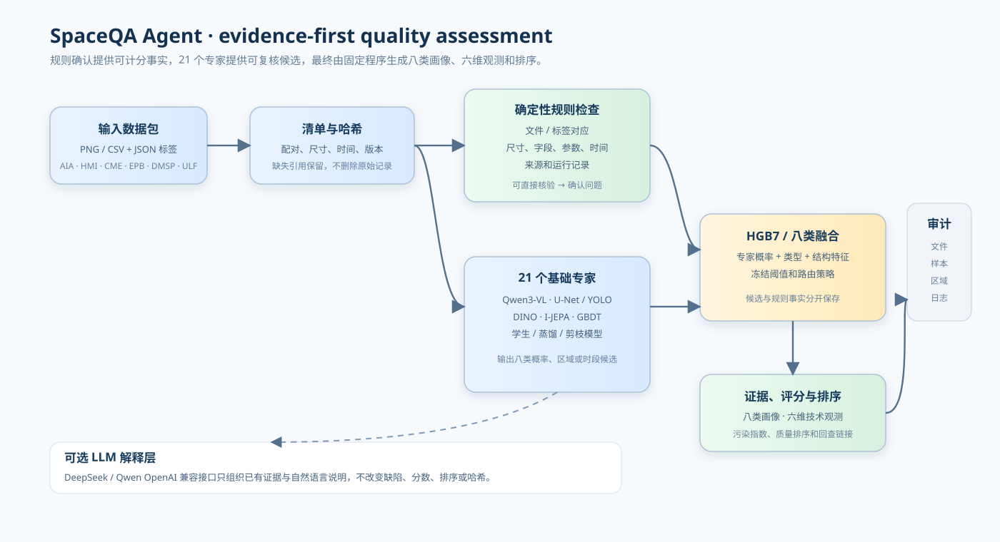

# SpaceQA Agent

SpaceQA Agent is an evidence-first quality assessment system for space-science datasets. It combines deterministic file and annotation checks, family-aware dispatch, expert candidates, and auditable reports. Given one package or a `publish/` root, it produces scorecards, eight-class findings, traceable evidence, ranking, and runtime logs.

[中文 README](README.md) · [Quick start](docs/quickstart.md) · [Architecture](docs/architecture.md) · [Offline deployment](docs/deployment_offline.md) · [Hardware and runtime](docs/hardware_runtime.md) · [Data contract](docs/data_contract.md) · [Reproducibility](docs/reproducibility.md) · [Documentation index](docs/README.md)

The six-family/eight-class review bundle can be exported with [`scripts/export_demo_subset.py`](scripts/export_demo_subset.py). It contains one small preview per family, aggregated eight-class metrics, and hashes; private data and weights are never committed.



## Version and scope

The current repository version is **0.6.0**. The compact research release keeps 21 base experts, the eight-class fusion policy, and the local Qwen3-VL NF4 runtime state. The rule runtime uses only the Python standard library. Real data, labels, model weights, caches, API keys, and per-sample run directories remain external and are excluded from GitHub.

The system has two explicit paths:

1. **Offline assessment** builds inventories and hashes, checks file/label pairing, dimensions, fields, time and provenance evidence, then computes deterministic scores and ranking.
2. **Model research and candidate localization** dispatches AIA, HMI, CME, EPB, DMSP, and ULF samples to visual, structural, and prior-aware experts. HGB7/eight-class heads produce candidates with evidence and probabilities. Without independent ground truth, candidates must not be reported as official precision, recall, or F1.

The project does not repair original data, calibrate instruments, infer noise causes, or treat roadshow candidate counts as official defect truth.

## Three-minute quick start

The deterministic scanner needs no model download or network access:

```bash
python -m venv .venv
source .venv/bin/activate                 # Windows: .venv\\Scripts\\Activate.ps1
python -m pip install -e .

spaceqa --version
spaceqa scan --input /absolute/path/to/publish \\
  --output /absolute/path/to/run-20261108 --seed 20261021
spaceqa audit /absolute/path/to/run-20261108
```

`--input` may be one package or a directory containing packages. The output must be new and outside the input. The legacy `python opc_agent.py scan ...` entry point remains supported. Limit a run to selected checks with `--checks C01,C02,C03`.

| Directory | Contents |
| --- | --- |
| `04_评分卡/` | Per-package dimensions and status |
| `05_排序表/` | Global ranking and ranking basis |
| `06_问题清单/` | Sample findings, candidates, locations, and status |
| `07_证据索引/` | File, hash, field, and image-region back references |
| `08_运行日志/` | Check IDs, rule version, seed, and timings |

`spaceqa audit` independently rereads these artifacts and recomputes evidence and ranking.

## Browser service

The service binds to loopback and is intended to run beside the data on a server, then be reached through an SSH tunnel:

```bash
spaceqa serve --host 127.0.0.1 --port 8765 \\
  --data-root /absolute/path/to/publish \\
  --run-root /absolute/path/to/historical-runs \\
  --state-dir /absolute/path/to/spaceqa-web-state
```

Forward the port locally and open `http://127.0.0.1:18765`. See [the browser-service guide](docs/web_service.md) for start/stop, package upload, conversational analysis, and API examples. Hostnames, users, and ports are supplied through arguments or environment variables rather than hard-coded in the project.

Both workbenches have a `中文 / EN` switch in the upper-right corner. The preference is stored in the current browser; system UI, tables, job states, filters and dialogs follow the selected language, while source filenames, JSON, evidence and model answers remain in their original form.

Before submission, run `python tools/audit_delivery.py /path/to/submission --json delivery_audit.json`. The check reports real missing files and required JSON/JSONL/CSV fields. See [`docs/delivery_audit_20261108.md`](docs/delivery_audit_20261108.md) and the PDF-ready sources in [`docs/delivery/`](docs/delivery/).

## Research models and optional LLM explanations

The research directories document six-family training, student models, U-Net/YOLO/DINO/I-JEPA, HGB7, and Qwen3-VL comparisons. Weights and training environments are external. Copy `configs/reproduce.example.json` to an ignored local file and run `scripts/reproduce.py preflight`. The explanation client is opt-in: it sends a request only when `SPACEQA_CHAT_LLM_BASE_URL`, `SPACEQA_CHAT_LLM_MODEL`, and `SPACEQA_CHAT_LLM_API_KEY` are explicitly configured. It organizes existing evidence and never changes defect decisions, scores, or ranking.

## Compact release and measured runtime

The server-side compact release is `spaceqa-agent-0.6.0-all21-nf4-20261107`. The Docker image is **19,748,024,384 bytes** and the raw `docker save` archive is **19,748,043,776 bytes**, both below the official `20,000,000,000`-byte limit. Offline, read-only-image loading and entrypoint acceptance passed. The release excludes datasets and API keys; hashes and the full receipt are summarized in `docs/release_metrics_0.6.0.md`.

On an A100 40GB GPU1, a fresh forward of all 21 experts over 18,450 grouped test records from all six families and 30 public packages took **3,124.28 seconds (about 52.1 minutes)**; Qwen NF4 accounted for 2,480.62 seconds. Compact and original releases produced identical aggregate technical-proxy metrics: Precision **95.15%**, Recall **94.95%**, F1 **95.05%**. The labels are derived from public P0 comparison data and are not independent official nine-class ground truth.

The official limit is also three hours per complete dataset on the target hardware. The full A100 run is within the limit, and throughput estimates put the largest public package near 30 minutes. **A10 24GB end-to-end acceptance is still pending**: Qwen NF4 peaked at about 30.8GB on A100, so A10 needs a smaller Qwen batch, staged expert loading, and a fresh memory/time measurement. We do not claim A10 acceptance from the A100 result.

## Reproduction, tests, and repository hygiene

```bash
python scripts/reproduce.py verify --manifest configs/source_manifest.json
python -m unittest discover -s tests -v
python -m compileall src scripts deploy tests
```

Research reproduction requires external data, manifests, prediction/registration caches, weights, and pinned environments. The repository alone cannot recreate those private inputs. `experiments/` keeps protocols and source code; generated runs, JSONL records, images, weights, and caches are ignored. Run a secret scan before committing, and provide credentials only through environment variables or ignored local files.

## Repository layout

```text
src/spaceqa_agent/    package, CLI, rules, audit, web, and chat service
agent/                agent capabilities, rules, and tool declarations
spec/                 defect catalog, quality specification, and input contracts
experiments/          training, fusion, localization, and runtime protocols
scripts/              reproduction, recomputation, and report export
configs/              external-path templates and source manifest
results/reference/    small aggregate metrics and provenance records
docs/                 architecture, deployment, hardware, and operator guides
tests/                regression tests without real datasets
```

Code, model, and third-party dependency licenses follow their respective files. The project does not imply endorsement by the competition organizer.
