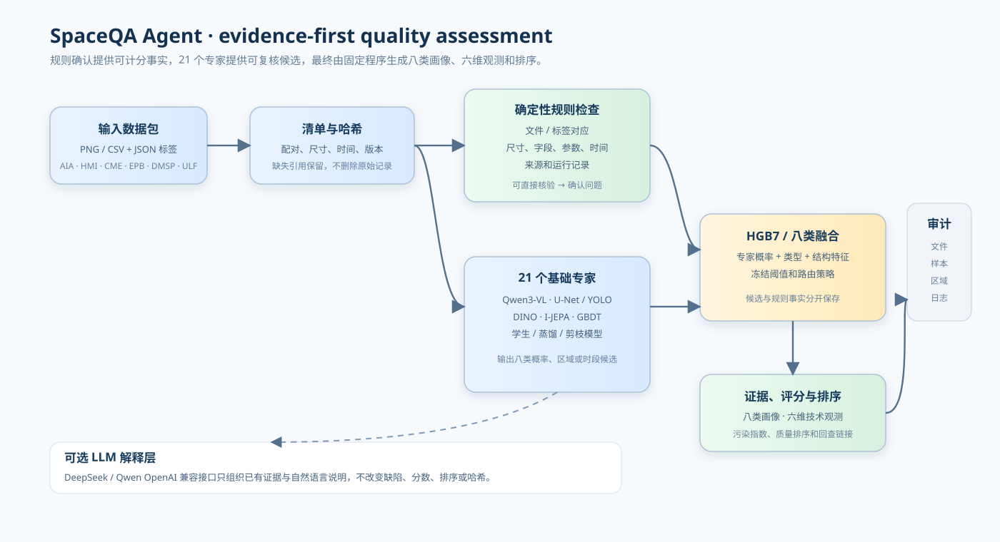

# SpaceQA Agent

空间科学数据集质量评价智能体。项目把确定性文件核验、数据类型分流、专家候选检测和可审计报告组合成一条离线流水线：输入一个数据包或 `publish/` 根目录，输出评分卡、八类问题清单、定位证据、排序和运行日志。

[English](README.en.md) · [快速开始](docs/quickstart.md) · [系统架构](docs/architecture.md) · [离线部署](docs/deployment_offline.md) · [硬件与耗时](docs/hardware_runtime.md) · [数据约定](docs/data_contract.md) · [复现说明](docs/reproducibility.md) · [评价规范与系统反思](docs/quality_evaluation_spec_v2.md) · [机器可读规范](docs/quality_evaluation_spec_v2.yaml) · [文档索引](docs/README.md)

AIA94 迁移采用后端策略插件，按六类数据选择不同的预处理和候选证据；增强模式把通过独立证据门槛的信号接入正式 finding、评分和排序，不替换训练权重、不改变聊天前端；`legacy` 可回退到迁移前判定。迁移说明和基线备份见 [AIA94 后端迁移说明](docs/aia94_backend_migration_20261108.md)。

六类 × 八类的小型审阅包由 [`scripts/export_demo_subset.py`](scripts/export_demo_subset.py) 从服务器私有数据导出；它包含六类各一个缩略图、八类统计和哈希，不把真实数据同步到仓库。



## 版本与边界

当前仓库版本为 **0.6.0**。默认研究发布保留 21 个基础专家、八类融合策略和本地 Qwen3-VL NF4 运行状态；规则运行时本身只依赖 Python 标准库。真实数据、标签、模型权重、缓存、API Key 和逐样本运行目录都在仓库外部提供，GitHub 中不包含这些内容。

系统有两条边界清晰的路径：

1. **正式离线评价**：建立清单与哈希，检查文件和标签配对、尺寸、字段、时间和可追溯证据；结果由程序确定性计分和排序。
2. **模型研究与候选定位**：按 AIA、HMI、CME、EPB、DMSP、ULF 分流，汇集视觉、结构特征和先验专家，再由 HGB7/八类头输出候选。没有独立真值的候选会保留证据和概率，不能直接包装成官方精确率、召回率或 F1。

项目不自动修复原始数据、不替代仪器定标、不判断观测噪声成因，也不把路演包的候选数当作官方缺陷真值。

路演页面另外展示八类污染指数：按类别阈值累计概率，指数越低越好；它是规则/模型观测量，没有独立真值时不等同官方污染率、Precision、Recall 或 F1。定位命中必须有独立参考，默认容差和专家 MAD 异常审计规则见[评价规范与系统反思](docs/quality_evaluation_spec_v2.md)。

问题案例核查 Demo 兼容旧地址 `evaluation.html`：当前服务启动后可通过
`http://127.0.0.1:18867/evaluation.html`（或 `/demo.html`）查看保存的运行、筛选问题并打开证据详情。
它直接读取当前 `/api/runs` 台账，不维护旧版 8775 服务的第二份数据。连接方式见[浏览器服务说明](docs/web_service.md)。

## 三分钟快速开始

规则扫描不需要大模型或网络：

```bash
python -m venv .venv
# Linux/macOS: source .venv/bin/activate
# Windows:     .venv\\Scripts\\Activate.ps1
python -m pip install -e .

spaceqa --version
spaceqa scan --input /absolute/path/to/publish \\
  --output /absolute/path/to/run-20261108 --seed 20261021
spaceqa audit /absolute/path/to/run-20261108
```

`--input` 可以是单个数据包，也可以是包含多个包的目录；输出目录必须是新的、且不能位于输入目录内部。传统入口 `python opc_agent.py scan ...` 仍可用。只需检查指定项目时可以传 `--checks C01,C02,C03`。

检查结果的主要位置如下：

| 目录 | 内容 |
| --- | --- |
| `04_评分卡/` | 每个数据包的维度得分与状态 |
| `05_排序表/` | 全局排序与排序依据 |
| `06_问题清单/` | 样本级问题、候选、定位和状态 |
| `07_证据索引/` | 文件、哈希、字段或图像区域的回查入口 |
| `08_运行日志/` | 检查编号、规则版本、随机种子和耗时 |

独立审计会重新读取这些产物并复算证据和排序：

```bash
spaceqa audit /absolute/path/to/run-20261108
```

## 浏览器服务

服务只监听本机回环地址，适合在服务器上运行后通过 SSH 转发到本机浏览器：

```bash
spaceqa serve --host 127.0.0.1 --port 8765 \\
  --data-root /absolute/path/to/publish \\
  --run-root /absolute/path/to/historical-runs \\
  --state-dir /absolute/path/to/spaceqa-web-state
```

然后在本机建立端口转发并打开 `http://127.0.0.1:18765`。完整的启动、停止、上传新包、对话式分析和 API 示例见[浏览器服务说明](docs/web_service.md)。服务器路径、用户名和端口均通过脚本参数或环境变量提供，不写入代码。

两个工作台右上角都提供 `中文 / EN` 切换。语言选择会保存在当前浏览器；系统界面、表格、任务状态、筛选器和弹窗会同步切换，原始文件名、JSON、证据内容和模型回答保留原文。

## 交付前审查

对冻结提交目录执行：

```bash
python tools/audit_delivery.py /path/to/<队伍代号> --json delivery_audit.json
```

该脚本只检查交付物是否真实存在、JSON/JSONL/CSV 必填字段、排序是否连续以及运行日志字段，不会把 README 中的描述当成证据。逐项说明见 [`docs/delivery_audit_20261108.md`](docs/delivery_audit_20261108.md)，四份可转 PDF 的交付源文件位于 [`docs/delivery/`](docs/delivery/)。

## 研究模型与可选大模型

研究目录记录了全六类训练、学生模型、U-Net/YOLO/DINO/I-JEPA、HGB7 和 Qwen3-VL 的协议与比较方法。模型权重和训练环境必须放在外部路径，使用 `configs/reproduce.example.json` 复制出一个被 `.gitignore` 忽略的本地配置后运行 `scripts/reproduce.py preflight`。模型解释接口是可选项：只有显式设置 OpenAI 兼容的 `SPACEQA_CHAT_LLM_BASE_URL`、`SPACEQA_CHAT_LLM_MODEL` 和 `SPACEQA_CHAT_LLM_API_KEY` 才会发起请求；它只组织已有证据，不修改缺陷判定、分数或排序。

## 最新压缩发布与实测

服务器上的正式压缩发布为 `spaceqa-agent-0.6.0-all21-nf4-20261107`。Docker 镜像为 **19,748,024,384 字节**，`docker save` 原始包为 **19,748,043,776 字节**，均低于官方 `20,000,000,000` 字节上限；断网、只读镜像、空 rootless 存储的加载和入口验收通过。发布包不含数据集和 API Key，哈希与完整验收记录见 `docs/release_metrics_0.6.0.md`。

在 A100 40GB GPU1 上，21 个专家对覆盖六类、30 个公开包的 18,450 条分组测试记录完成真实前向，总耗时 **3,124.28 秒（约 52.1 分钟）**，其中 Qwen NF4 为 2,480.62 秒。压缩前后总体技术代理指标完全一致：Precision **95.15%**、Recall **94.95%**、F1 **95.05%**。这些标签来自公开 P0 对照推导的技术代理，不能替代组委会独立九类真值。

官方还要求指定硬件上单个数据集完整评价不超过 3 小时。当前全量实测在 A100 上满足；按实测吞吐估算最大公开包约 30 分钟量级。**A10 24GB 上尚未完成正式端到端验收**，原因是 Qwen NF4 在 A100 上峰值显存约 30.8GB，A10 需要降低 Qwen batch、分时加载专家并重新记录显存和耗时。仓库不把 A100 结果写成 A10 已验收结论。

## 复现、测试与代码规范

```bash
python scripts/reproduce.py verify --manifest configs/source_manifest.json
python -m unittest discover -s tests -v
python -m compileall src scripts deploy tests
```

研究复现需要外部数据、清单、预测/注册缓存、模型权重和锁定环境；仅克隆仓库不能重建这些私有输入。`experiments/` 只保存研究代码和协议，生成的运行目录、逐样本 JSONL、图片、权重和缓存由 `.gitignore` 排除。提交前请运行敏感信息扫描，并确保密钥只来自环境变量或本地忽略文件。

## 目录

```text
src/spaceqa_agent/    安装包、CLI、规则引擎、审计、网页和对话服务
agent/                智能体能力、规则和工具声明
spec/                 缺陷目录、质量规范和输入契约
experiments/          训练、融合、定位和运行验收协议
scripts/              复现、复算和报告导出入口
configs/              外部路径模板与来源清单
results/reference/    小型聚合指标和来源记录
docs/                 架构、部署、硬件和操作文档
tests/                不依赖真实数据的回归测试
```

代码许可和模型/第三方依赖许可分别遵循各自文件；项目不代表比赛组织方背书。
