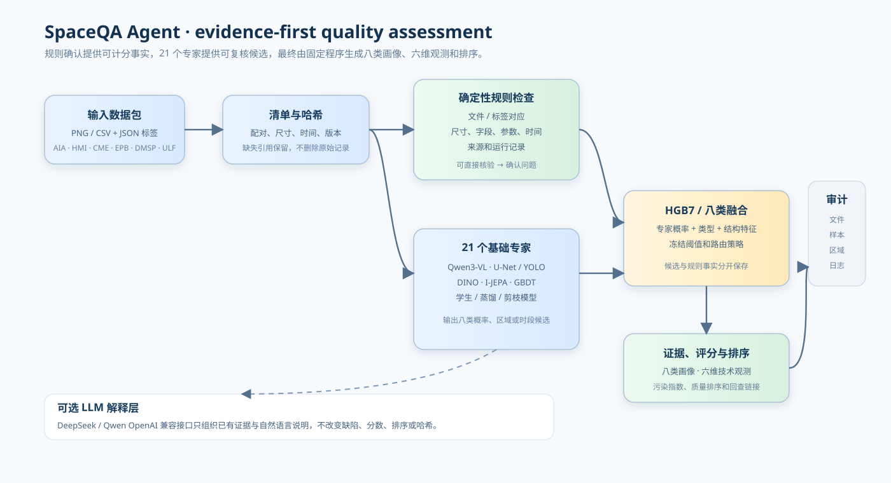

# 系统架构与数据流

SpaceQA 的输入是一个数据包目录或 `publish/` 根目录。程序先登记文件、标签、哈希和版本，再按数据类型选择适用检查。规则确认和模型候选始终分开：规则可以直接计分，候选必须保留概率、定位和证据状态。

## 数据流

1. **输入与清单**：识别六类数据（AIA、HMI、CME、EPB、DMSP、ULF），配对 PNG/CSV 与 JSON 标注，记录缺失引用、尺寸、时间和 SHA-256。
2. **确定性规则**：检查文件缺失、孤儿标注、字段和尺寸矛盾、参数冲突、时间格式和来源链。可直接核验的结果进入证据台账。
3. **专家分流**：图像进入视觉语言或视觉骨干专家；CSV 和结构化字段进入结构特征/先验专家。每个专家输出八类缺陷的概率或候选定位，不改写原始标签。
4. **融合与定位**：HGB7 根据专家输出、数据类型和结构特征给出八类候选；图像定位器提供框/掩膜/时段候选。定位证据带有坐标系或字段指针。
5. **评分和排序**：程序按固定阈值、统计分母和四状态规则计算六维技术观测、污染指数和全局排序；缺少独立真值的维度保留证据缺口，不补零或满分。
6. **审计导出**：评分卡、问题清单、证据索引和运行日志都可回查到文件、样本、标注记录或区域，审计程序重新计算引用和排序。

## 八类缺陷与证据

八类缺陷统一使用 `spec/fine_review_eight_schema.json` 的代码。文件缺失和字段矛盾主要由规则确认；边界、漏标、虚标和覆盖偏差由专家产生候选并可由人工/独立参考复核。路演数据没有独立真值时，报告中会明确区分“已确认”和“模型候选”，不把候选 F1 写成官方成绩。

## 组件边界

- **规则引擎**负责可复算事实，不调用外部模型。
- **专家执行器**负责产生概率、候选区域或时间区间；权重和 GPU 环境在仓库外部。
- **HGB7/八类融合**负责整合信号与阈值决策，不负责替代证据。
- **可选 LLM**只组织已有检查结果和解释文字；它不能改变分数、排序、证据哈希或状态。
- **审计器**负责验证产物完整性和复算链路，而不是证明科学结论本身正确。

## AIA94 后端策略迁移

`src/spaceqa_agent/backend_strategy.py` 提供按数据类型选择的后端策略。AIA/HMI 使用 AIA94 启发的元数据和亮区候选上下文，EPB/DMSP 使用几何区域策略，CME 使用事件参数/时间上下文，ULF 使用完整 CSV 时间轴策略。正式 `scan` 在基础规则之后调用 `engine.apply_backend_checks`：通过独立证据门槛的曝光异常和无效时间轴信号会生成标准 finding，进入证据、评分和排序；亮区候选、缺少科学侧车和无明确几何的情况只保留观测或待判定。服务支持 `backendProfile=legacy` 回退到迁移前策略。
