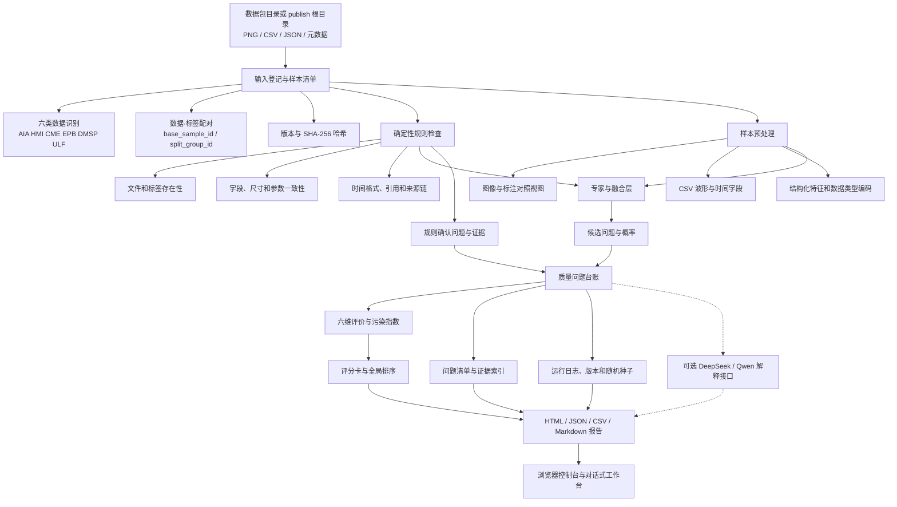
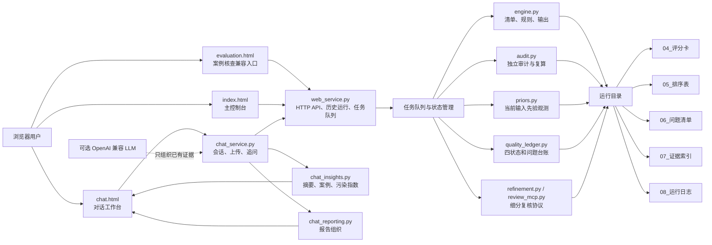
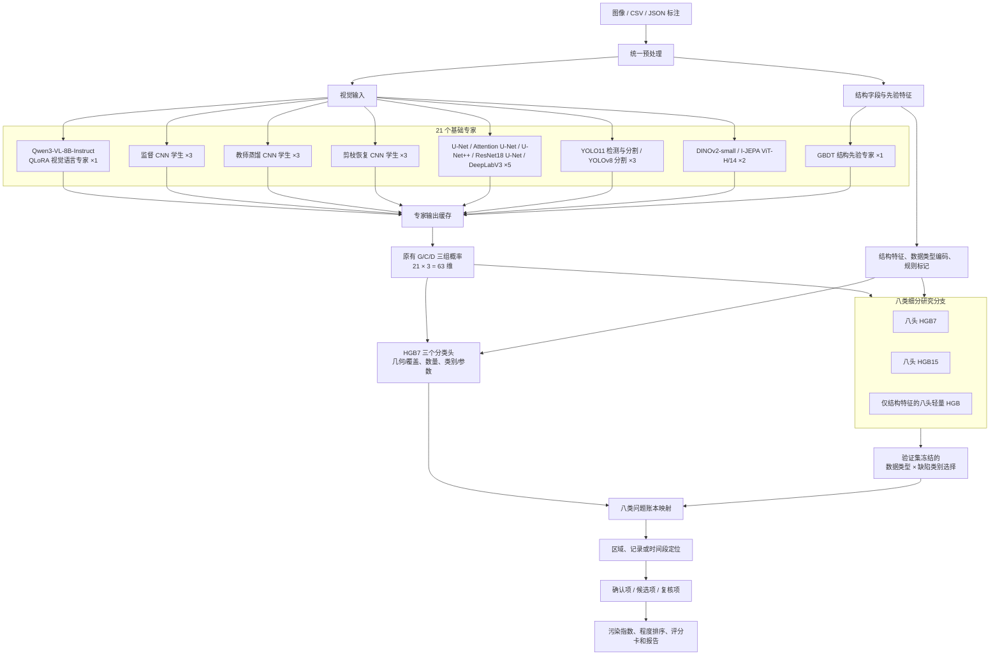

# SpaceQA 项目结构与阶段交接总结

更新时间：2026-11-08  
项目版本：`spaceqa-agent 0.6.0`

## 一、项目要解决什么问题

SpaceQA 面向空间科学数据集质量评价。输入一个数据包或 `publish/` 根目录，系统读取图像、CSV 时间序列、JSON 标注和元数据，检查数据文件与标签是否匹配，识别可核验的问题，保留模型候选和定位证据，最后生成评分卡、污染指数、全局排序、问题清单、证据索引和运行日志。

系统覆盖六类数据：AIA、HMI、CME、EPB、DMSP 和 ULF。前五类主要是图像及 JSON 标注，ULF 主要是 CSV 时间序列及事件字段。公开数据按 P0～P4 组织，同源样本按 `base_sample_id`、重复内容按 `split_group_id` 分组，避免同一原始样本的不同档位跨训练集和测试集泄漏。

系统的核心原则是：确定性规则负责可复算结论，视觉/结构专家负责候选和定位，融合器负责综合概率，评分程序负责计算分数和排序，LLM 只负责组织解释文字，不能修改问题状态、证据、分数或排序。

## 二、总体系统结构



总体流程分为五步：先建立清单，再执行规则检查；然后为适用数据生成模型输入；模型输出候选概率和区域/时段定位；最后把确认问题、候选问题、证据和四种状态汇总为评分卡和报告。

## 三、后端结构与调用关系



后端有两条边界清晰的路径：

1. **正式规则评价路径**：`scan → engine → audit → score/rank/report`，不依赖大模型和网络。
2. **对话与案例路径**：`chat_service → web_service → 历史运行/案例/追问`，可调用 DeepSeek 或 Qwen 生成解释，但解释层不改变正式判定。

主要入口如下：

| 能力 | 入口 | 状态 |
|---|---|---|
| 规则扫描 | `src/spaceqa_agent/cli.py`、`engine.py` | 已可运行 |
| 独立审计 | `src/spaceqa_agent/audit.py` | 已可运行 |
| 六维评分和排序 | `quality_ledger.py`、`chat_scoring.py` | 已实现 |
| 证据和问题清单 | `engine.py`、`instance_audit.py` | 已实现 |
| 对话工作台 | `chat_service.py`、`chat_insights.py` | 已实现 |
| 浏览器服务 | `web_service.py`、`web/` | 已实现 |
| 细分复核 | `review_mcp.py`、`refinement.py` | 协议和测试已实现 |
| 模型实验 | `experiments/` | 研究代码和历史结果已归档 |

## 四、模型与融合结构



当前模型层需要区分“默认融合”和“研究分支”：

- **默认融合**：21 个基础专家提供 G/C/D 概率，HGB7 综合专家概率、结构特征和规则标记，再映射到八类问题账本。
- **八类研究分支**：训练八个多标签头，比较 HGB7、HGB15 和轻量结构特征分支，按验证集的“数据类型 × 缺陷类别”冻结选择。它是可替换候选，不会自动覆盖默认模型。
- **定位分支**：U-Net 等模型用于生成图像区域候选；CME 主要检查事件参数，ULF 主要检查时间序列和时间字段，不能把它们强行转成图像掩膜。
- **LLM 解释层**：接收图像、标签、专家输出和证据摘要，生成结构化解释；不参与正式分数计算。

八类缺陷代码如下：

| 代码 | 含义 | 当前主要方式 |
|---|---|---|
| L0-01 | 数据文件缺失 | 文件引用和存在性规则 |
| L2-G | 边界与位置偏差 | 区域候选、IoU、中心距离或边界距离 |
| L2-P | 类别标注错误 | 类别契约、字段规则和语义候选 |
| L2-T | 时段起止时刻抖动 | 时间字段顺序、端点和时间基准检查 |
| L2-F | 元数据尺寸矛盾 | 声明尺寸与实测尺寸比较 |
| L3-06 | 漏标 | 参考目标与标注对象匹配后的缺失候选 |
| L3-07 | 虚标 | 标注对象与可靠目标证据不匹配 |
| L3-MIS | 覆盖不足或覆盖过度 | 面积、时段或区域覆盖比例 |

## 五、评分、污染指数和证据链

### 1. 四种检查状态

每条检查使用：`通过`、`不通过`、`待判定`、`不适用`。已确认问题进入正式技术观测；模型候选保留概率、位置和证据状态，不能直接冒充确认问题。

### 2. 六维技术观测

六维分别是完整性、标注质量、样本对应、覆盖与分布、文档与来源追溯、使用条件。每个维度记录适用分母、完成比例、证据引用和未决原因。缺少适用材料时不强行补零或补满分。

### 3. 污染指数

对缺陷类别 `c`，程序按固定阈值统计超过阈值的样本概率贡献：

```text
PI_c = 100 × Σ_i [p(i,c) ≥ threshold_c] × p(i,c) / N
PI_total = Σ_c PI_c
```

污染指数越低越好，按 `PI_total` 升序排序。规则确认问题使用 `p=1` 作为诊断贡献，但这不等于模型置信度，也不等于官方召回率。

### 4. 证据回查

每条问题记录保存样本 ID、缺陷代码、状态、概率、程度、文件路径、JSON Pointer 或图像区域/时间段、证据 ID、规则版本和输入哈希。结果可以从评分卡回查到问题清单，再回查到源文件和运行日志。

## 六、已经完成的调研、实现和验证

| 调研/开发问题 | 完成方式 | 当前结果 |
|---|---|---|
| 系统到底有哪些真实模块 | 检查 CLI、引擎、审计器、Web、聊天、MCP 和实验目录 | 已形成架构审计和入口索引 |
| 数据如何进入系统 | 核对六类数据契约、样本清单、配对字段和哈希记录 | 已实现数据登记、配对、版本和分组 |
| 问题如何识别 | 对照规则检查、专家候选、HGB 融合和八类账本 | 已形成确认项、候选项和复核项分层 |
| 评分与排序是否可复算 | 检查评分卡、污染指数、排序表和审计器 | 已实现评分、排序和证据回查 |
| 复核协议是否可靠 | 运行双人复核测试，修复图像尺寸解析和一致性统计 | 复核协议 10/10 通过 |
| 代码是否可运行 | 运行全仓库回归和编译检查 | 238/238 测试通过，4 项条件跳过 |
| 是否能复现当前源码 | 生成并验证 SHA-256 来源快照 | 484 个文件、17 项源码检查、3960 项指标复算通过 |
| 模型方案如何组织 | 归档 Qwen、CNN 学生、U-Net、YOLO、DINO、I-JEPA、GBDT 和 HGB 实验 | 默认融合与八类研究分支边界已明确 |
| 是否满足体积和运行时间 | 核对历史发布收据和运行基准 | 已记录 0.6.0 镜像约 19.748 GB、A100 历史全量约 52.1 分钟 |
| 前端是否保留旧入口 | 测试聊天工作台、`evaluation.html` 和 `demo.html` | 旧案例核查入口和对话式工作台均保留 |
| 如何交接给其他成员 | 汇总审计、测试、规范、缺口、来源快照和启动说明 | 已生成交接压缩包 |

## 七、问题清单与当前状态

### 已解决或已具备

- 规则扫描、审计、评分卡、全局排序和证据索引主流程已具备。
- 八类问题账本、污染指数和程度字段已接入结果结构。
- 对话式工作台、案例核查、历史运行查看和报告导出接口已具备。
- 复核协议中的图像尺寸校验和双人一致性统计问题已修复。
- 代码入口、测试入口和源码快照已固定。
- 真实数据、模型权重、缓存和密钥不会进入 Git 或交接客户端包。

### 仍需工程收尾

| 问题 | 当前状态 | 后续动作 |
|---|---|---|
| A10 指定硬件验收 | A100 有历史记录，A10 尚未完成端到端收据 | 在 A10 记录单包耗时、峰值显存、CPU/RAM 和容器日志 |
| 最终交付材料 | Markdown、YAML 和部分 PDF 源具备，最终冻结 PDF、镜像 tar、视频仍需归档 | 由交付负责人从同一个 `runId` 复制并执行 `audit_delivery.py` |
| 21 专家独立前向证明 | 部分历史运行使用校验缓存 | 对正式输入保存每个专家的输入哈希、权重哈希、耗时和输出哈希 |
| LLM 外部接口验收 | OpenAI 兼容接口和结构化解释代码具备 | 补充 API smoke、超时/重试、脱敏和离线降级记录 |
| EPB 多边形 | 输入只有矩形时系统保留矩形 | 若比赛要求多边形，需要真实多边形标注或明确矩形评价口径 |
| 干净客户端验收 | 当前已提供 IP 启动和服务说明 | 在另一台 Windows 电脑完成 SSH、启动、浏览和导出全流程 |
| 可选测试环境 | SciPy 定位器和 Windows 目录软链接条件不足 | 在目标 Linux/GPU 环境补做可选测试 |

### 外部数据条件，不归为本系统功能缺陷

路演或隐藏数据集是否提供独立缺陷真值、实例区域、时间端点和用途材料，属于赛事数据条件。系统已经提供候选输出、定位字段、证据索引、污染指数、评分卡和复核接口；正式 Precision、Recall、F1 只需在外部参考答案提供后通过 `instance_audit` 计算，不需要改变系统主架构。

## 八、交接与运行入口

安装和回归：

```powershell
cd D:\OPC\spaceqa-agent
python -m pip install -e .
$env:PYTHONPATH = "src"
python -m unittest discover -s tests -v
```

规则扫描和审计：

```powershell
spaceqa scan --input <数据包或publish根目录> --output <新运行目录> --seed 20261021
spaceqa audit <运行目录>
```

浏览器服务：

```powershell
spaceqa serve --host 127.0.0.1 --port 8765 `
  --data-root <数据根目录> `
  --run-root <历史运行目录> `
  --state-dir <状态目录>
```

主要交接文件：

- `docs/PROJECT_AUDIT.md`：系统架构和文件索引；
- `docs/TEST_MATRIX.md`：测试命令和收据；
- `docs/DEVELOPMENT_GAPS.md`：P0/P1/P2 缺口；
- `docs/quality_evaluation_spec_v2.md` 与 `.yaml`：评价规范；
- `configs/source_manifest_20261108_final.json`：源码来源快照；
- `outputs/spaceqa_handoff_20261108.zip`：交接材料压缩包。

## 九、结论

当前项目已经具备从数据接入、规则核验、专家候选、融合判断、证据回查、评分排序到浏览器展示的完整软件链路。下一阶段主要是指定硬件验收、最终材料归档、独立前向收据和外部接口的工程收尾；路演/隐藏集真值由数据提供方负责，不影响本系统功能链路的完成状态。
