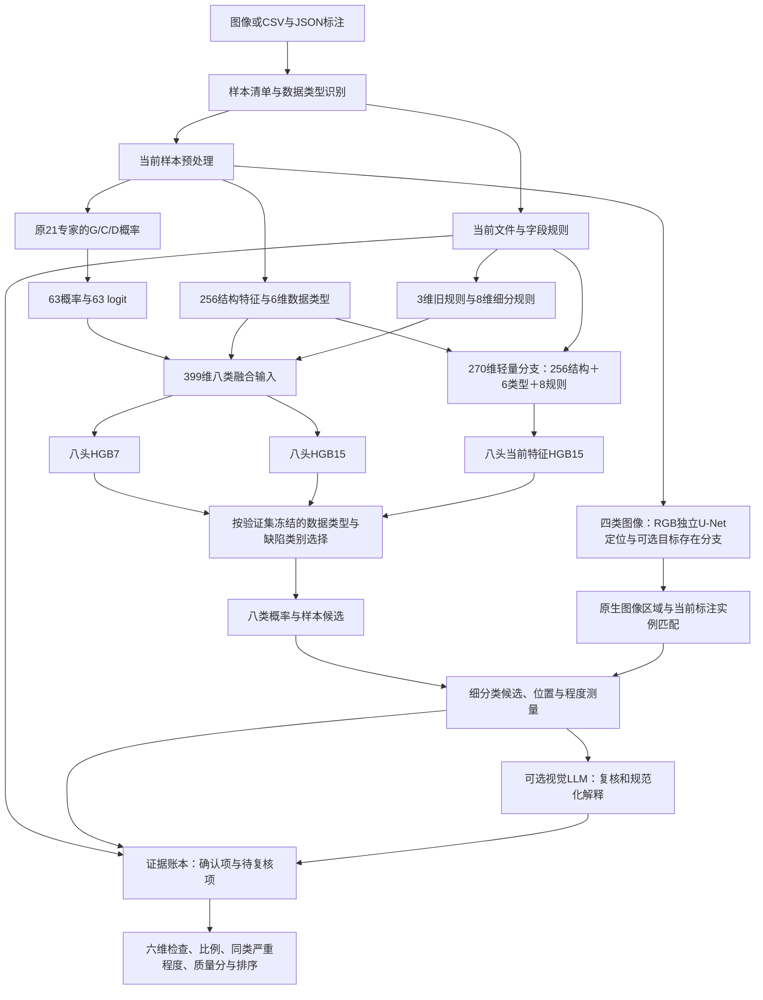

# 八类细分类与定位：24小时补全实验

本实验给现有 G/C/D 三组疑点增加八类多标签输出，并加强独立图像定位。旧 HGB7、原始数据、已有网页服务和正式交付包均保留。新模型完成训练不等于自动升级；按分组验证结果选择细分类配置，测试集与路演数据不用于选参数。

## 输出的八类是什么

| 分类头 | 含义 | 确认依据或定位方式 |
|---|---|---|
| L0-01 | 数据文件缺失 | 文件存在性、预期文件路径；L0-03作为别名合并 |
| L2-G | 边界与位置偏差 | 图像区域对比；CME角度位置单独解释 |
| L2-P | 类别标注错误 | 明确任务词表的规则证据，或模型语义候选 |
| L2-T | 事件时刻或起止时刻偏差 | 标注记录与时间字段；事件时点和区间端点分别说明 |
| L2-F | 元数据尺寸矛盾 | 当前PNG头与整图尺寸声明逐字段比较 |
| L3-06 | 漏标 | 预测目标有对应区域、输入标注缺对应目标时给候选 |
| L3-07 | 虚标 | 需要足够可靠的负证据；模型未检出不能单独证明虚标 |
| L3-MIS | 覆盖不足或覆盖过度 | 区域交并、覆盖比例与面积；CME角宽单列 |

同一样本可以有多类问题，因此用八个二分类头，而非只能选一个答案的八选一分类。HGB7的“7”仍指每棵树最多7个叶节点。

## 完整数据流



这里的399维是63＋63＋256＋6＋3＋8。新八类规则标记与旧三个G/C/D规则标记并存，是显式当前输入检查结果，未加入P0答案、污染档位、样本编号或目标标签。270维轻量分支不需要运行21个专家，作为真实可用的对照候选。

21个旧专家分别为：Qwen3-VL-8B-Instruct QLoRA 1个；监督CNN、蒸馏CNN、剪枝恢复CNN各3个种子，共9个；U-Net、Attention U-Net、U-Net++、ResNet18 U-Net、DeepLabV3 MobileNet、YOLO11检测骨干、YOLO11分割骨干、YOLOv8分割骨干、DINOv2-small、I-JEPA ViT-H/14共10个；GBDT先验1个。每个输出G/C/D三个概率，合计63维。本轮分类训练与路演复用经校验的专家预测，不是重新训练这21个专家，也不能将本轮融合耗时当成完整21专家推理耗时。

新定位U-Net与以上旧U-Net分类骨干是两份不同权重。旧骨干给样本级三个概率；新定位分支给四类图像各一张像素概率图和一个目标存在概率，按已知数据类型选择对应输出。

三种新分类配置都实际训练了八个头：HGB7每头150轮、最多7叶；HGB15每头200轮、最多15叶；学习率均0.05、最小叶样本20、L2正则5。缺文件、明确类别词表及尺寸矛盾优先使用规则；模型选择由验证集按“类型×缺陷”冻结，不按未知的污染档位路由。八类是多标签任务，同一样本可同时有边界与覆盖问题。

## 训练与评估

1. 沿用按原始样本与重复内容分组的70%/15%/15%划分，覆盖六类与30包；不重新随机拆散P0～P4。
2. 当前特征模型在全部原训练组学习。融合模型使用原验证集的60%训练、20%定阈值、20%选择；全部数据类型训练完成后才评估。
3. 标签是保守的P0相对技术弱监督：对象配对不确定时保留未知；图像像素改变时屏蔽几何、覆盖、数量的clean对照答案。未知项既不当负例，也不计入已知项F1。
4. 固定模型、阈值及选择策略后，评估原测试集全部30包，输出每包与每个细分类的精确率、召回率、F1及已知/未知样本数。
5. 另外报告几何、时间、漏标、虚标、覆盖五类弱监督指标，避免文件存在性等简单检查把综合指标抬高后掩盖难项。
6. 路演12包使用冻结模型推理，不加入训练。没有独立细分缺陷真值，不能把模型自身输出当答案计算路演F1。

时间监督另存补充版本：ULF使用相同CSV对应的P0观测窗口起止声明；CME使用同图像且速度三元组唯一不变的事件时刻候选配对。后者仅是次级弱监督，训练权重减半，并在严格配对指标中排除。两者均不能冒称独立事件起止定义；时间子类型和适用范围随结果记录。

旧21专家曾使用原验证集选择权重，因此融合内部划分不是严格嵌套交叉验证。原测试集也曾用于历史模型报告；本轮不使用其成绩挑选新配置，但不能称为全新盲测。

## 定位训练参数

U-Net基础通道32，1,950,824参数，384×384输入，batch 16，AdamW初始学习率0.0003，12轮，bfloat16。联合训练AIA、HMI、EPB、DMSP四类全部可用P0训练图像，保留空掩膜训练样本。对比含目标存在损失与不含该损失的两组；按验证集正样本Dice和空样本误报约束冻结阈值。

网络只读取原始RGB。训练裁剪可以使用训练掩膜，推理区域由图像尺寸确定，绝不使用clean标注裁剪。当前标注仅在网络预测之后参与实例对比。CME是角度/事件参数，ULF是时间序列，不能伪造它们的像素掩膜；它们仍进入六类联合细分类和对应字段检查。

本轮新定位的验证与路演部署采用整图384×384输入，然后将区域坐标映射回原图；训练包含全图与局部视图。尚未把更大分辨率滑窗推理作为经过本轮验证的新默认配置。

定位阈值保留两套实验：第一套限制空标注样本误报率，以检验保守运行时能保留多少目标；第二套最大化验证集前景像素Dice，供候选调查。若严格约束导致全空输出，会如实保留0 IoU/Dice。第二套同时公开阳性IoU/Dice和空样本误报率，不把它当作已确认缺陷检测器。部署仅在验证集选择，原测试集用于报告。

定位和新旧模型比较采用batch 16、6个图片读取进程。新定位的两组12轮权重先全部训练完，再开始验证与测试。未使用存在损失的模型不使用其未经训练的存在分类头。图像网络只处理AIA/HMI/EPB/DMSP，CME与ULF仍进入六类分类、对应参数和时间检查。

## 从八类到位置、程度和报告

- 模型给八类样本概率；规则或独立RGB区域预测给出原文件位置、JSON Pointer、原图坐标和校验哈希。大类C仍可触发额外漏标调查，但其概率另记为`fusion_group_probability`，不会冒充八类`fusion_class_probability`。
- 图像预测组件与当前标注做一对一匹配，再计算IoU、覆盖率、面积比例与中心距离。无法匹配的预测目标是漏标候选；没有预测目标不足以证明虚标。
- 依用户提出的“个数×概率÷样本总数”导出`candidate_risk.csv`，作为候选风险；单样本可有多处问题，实例风险可超过1，因此不称为真实污染比例。确认问题比例另算，未知项给出范围。
- `candidate_severity.csv`只按同包、同缺陷、同指标和单位比较严重程度，置信度不替代区域或时间误差。评分卡里的已确认问题、候选和四种检查状态分开保留。
- 12包各2例的视觉API试验使用当前数据、标注、21专家概率、八类概率和当前字段，经过八类JSON协议验证。API模型为`qwen3.8-chat`；文本DeepSeek接口不能代替图像输入。格式通过不代表科学准确率。

## 不可混淆的结果

- 八类样本分类概率不是问题个数，也不是已经确认的问题位置。
- 模型未检出目标不能证明当前标注是虚标；不具备可靠负证据时保留待复核。
- P0相对变化是技术代理监督，不能替代独立科学缺陷真值；本实验不能据此声称达到官方关键缺陷召回门槛。
- 六个评价维度比八类内容缺陷更广；来源、许可、分布基准不能通过增加八个分类头自动补齐。
- 模型概率未做科学可靠性校准，不能直接将“个数×概率”称为真实污染率。确认比例与模型候选风险分别导出。
- 分数与排序由可复算程序计算，模型与LLM仅提供候选或可核验证据；待复核项不能直接作为确认项扣分。

## 服务器结果与查看

实验根目录：`/staff/tangjiarui/OPC/eight_class_20261104/`

| 路径 | 内容 |
|---|---|
| `pipeline_v2_state.json` | 当前分类与路演自动接续流程状态 |
| `targets_v2/state.json` | 原始严格八类标签准备进度 |
| `targets_v3/protocol.json` | 当前标签覆盖、未知原因、时间监督等级与分组记录 |
| `localizer_v2/state.json` | GPU1定位训练与评估进度 |
| `localizer_v2/comparison.json` | 两组定位模型验证/测试指标，完成后生成 |
| `fusion_v2/frozen_policy.json` | 当前冻结的八头模型、阈值与按类选择策略 |
| `fusion_v2/all30_test.csv` | 全30包分类指标，含分开说明的弱时间项 |
| `fusion_v2/all30_classes_strict_mask_test.csv` | 全30包×八类细分指标，排除CME候选配对时间项 |
| `fusion_v2/comparison.json` | 各方案汇总对比，两种配对掩码分别保留 |
| `roadshow_v2/package_summary.csv` | 12包八类候选与规则确认数量 |
| `roadshow_v2/ranking.csv` | 规则证据口径的技术排序，非官方未知真值排序 |
| `spatial_comparison_v1/deployment_policy.json` | 新旧定位模型按验证集选择的配置，完成后生成 |
| `candidate_comparison_v1/deployment_policy.json` | 验证集像素Dice选择的候选调查配置；同时公开空样本误报 |
| `grounded_roadshow_v1/` | 定位完成后的12包细分区域候选与评分卡 |
| `grounded_roadshow_v1/candidate_risk.csv` | 分类概率加权的候选风险，非确认污染率 |
| `grounded_roadshow_v1/candidate_severity.csv` | 同类、同指标的候选程度及排序 |
| `visual_review_v4/receipt.json` | 24案例视觉API复核实际成功量与失败保留 |
| `completion_state.json` | 定位训练后的比较、定位与报告接续状态 |

只查看进度：

```bash
ssh icarus0 'cat /staff/tangjiarui/OPC/eight_class_20261104/pipeline_v2_state.json'
ssh icarus0 'cat /staff/tangjiarui/OPC/eight_class_20261104/localizer_v2/state.json'
ssh icarus0 'tail -n 12 /staff/tangjiarui/OPC/eight_class_20261104/fusion_v2.log'
```

任务通过独立后台进程接续，关闭本机SSH窗口不会终止。失败写入对应日志与`failure.json`，不把部分训练结果覆盖正式模型。

查看新报告：`http://127.0.0.1:18770/classification.html`。若本机隧道已关闭：

```bash
ssh -N -L 18770:127.0.0.1:18770 icarus0
```

本轮模型权重：`fusion_v2/models.pkl`保存三组八头，`fusion_v2/frozen_policy.json`记录实际按类选择；`localizer_v2/presence_gated.pt`、`localizer_v2/no_presence_loss.pt`保存两份定位权重。原21专家仍按既有权重与预测来源引用，增量实验目录不含它们的重复副本。本轮报告页面独立于18767旧网页；新模型并未自动替换旧服务默认模型。

在服务器复算八类分类与路演分类，需原专家缓存及数据仍在，且使用新的输出目录：

```bash
cd /staff/tangjiarui/OPC/eight_class_20261104
export PYTHONPATH="$PWD/runtime/src"
PY=/staff/tangjiarui/OPC/.venv-image-models/bin/python
"$PY" code/fusion.py --targets "$PWD/targets_v3" --output "$PWD/fusion_reproduce"
"$PY" code/roadshow.py --fusion "$PWD/fusion_reproduce" --output "$PWD/roadshow_reproduce"
```

已完成权重的批量定位评估入口为`evaluate_localizer.py`；候选阈值比较入口为`candidate_localizer.py`，不重新训练。代码、规范和报告可打包同步；原始数据、API密钥、模型权重留服务器。
